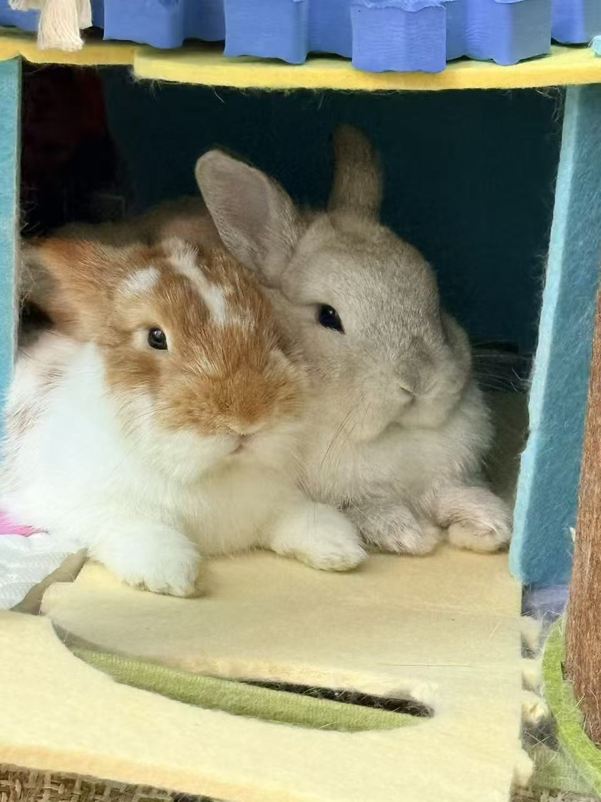
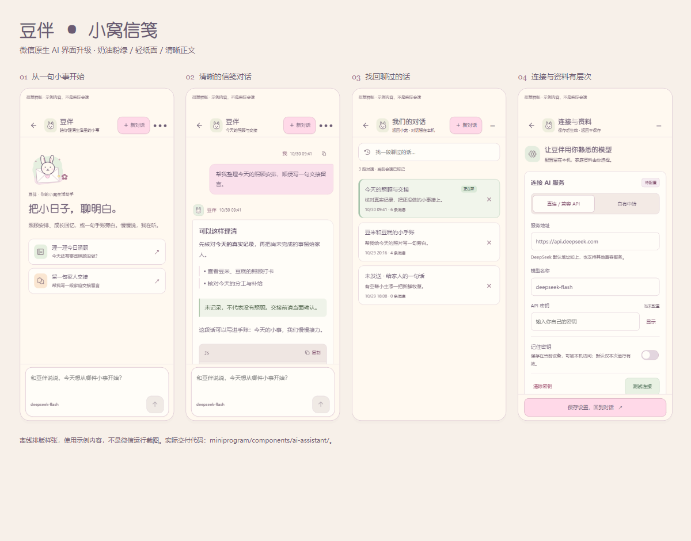
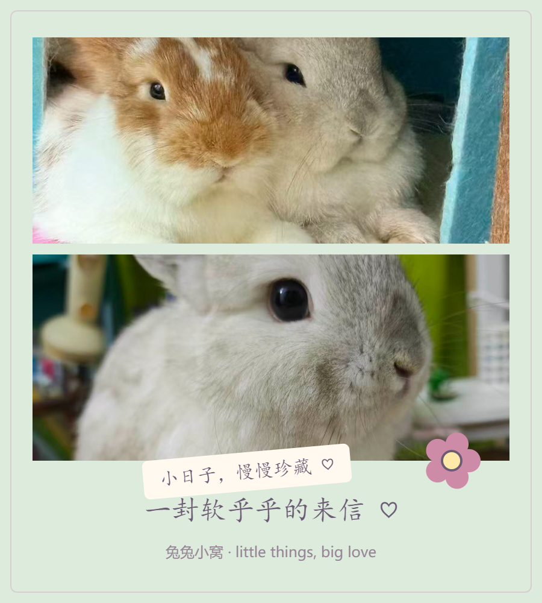

<div align="center">


# 兔兔小窝 · Bunny Family

**把豆米和豆糕的小日子，慢慢收藏起来。**

一款微信原生家庭手账：记录照顾、收藏回忆、制作照片手作，和豆伴一起整理日常。

[](https://developers.weixin.qq.com/miniprogram/dev/framework/)
[](miniprogram/)
[](#豆伴-ai)
[](LICENSE)

[功能一览](#功能一览) · [快速开始](#快速开始) · [配置指南](docs/配置与数据存储及上云指南.md) · [后续上云](#后续上云) · [开源协议](#开源协议)



**白兔是豆米，黄兔是豆糕。**

奶油纸张 / 樱花粉 / 薄荷绿 / 拍立得 / 胶带 / 胶片 / 故事目录

</div>

---

> **主项目是微信原生小程序，入口在 `miniprogram/`。** 仓库同时保留 React / Vite 辅助原型，浏览器预览不等于小程序效果。
>
> 当前资料保存在设备本地，**云同步尚未实现**。AI 为可选能力，不配置也可使用手账、照顾与工坊。

<details>
<summary><strong>阅读目录</strong></summary>

- [项目特色](#项目特色)
- [界面与作品预览](#界面与作品预览)
- [功能一览](#功能一览)
- [快速开始](#快速开始)
- [配置入口](#配置入口)
- [豆伴 AI](#豆伴-ai)
- [数据存储与隐私](#数据存储与隐私)
- [后续上云](#后续上云)
- [目录与技术结构](#目录与技术结构)
- [开发与验证](#开发与验证)
- [常见问题](#常见问题)
- [参与贡献](#参与贡献)
- [文档导航](#文档导航)
- [开源协议](#开源协议)

</details>

## 项目特色

| 方向 | 具体体验 |
| --- | --- |
| 真实的家庭记录 | 双兔独立打卡、体重与健康日期、家庭成员分工；未填写的信息保持空白 |
| 有温度的手账 | 真实照片、拍立得纸卡、胶带、胶片放映与故事目录；没有传统底部 tabBar |
| 可操作的创意工坊 | 十套模板、逐镜头构图、文字与贴纸图层、四种笔刷、撤销重做、图片导出 |
| 可控的 AI 助手 | 直连或中转、连续会话、可预览的资料范围、流式回答与停止生成 |
| 清晰的能力边界 | 不伪造打卡、AI 回复、云同步或视频成片；离线样张与真机验收分开说明 |

## 界面与作品预览

### 豆伴 · 从连接到对话



*根据原生 WXML / WXSS 生成，使用隔离示例资料；不是微信真机截图，也不是模型实际回答。*

### 工坊 · 把照片做成一封小小的来信

<div align="center">


*「双兔来信」900 × 1000 样张，来自实际绘图管线。*
</div>

图片来源与授权见 [素材许可说明](THIRD_PARTY_NOTICES.md)。上述展示不代表已完成微信模拟器或真机全流程验收。

## 功能一览

项目包含 **9 个原生页面、7 个自定义组件**，豆伴以可唤起组件接入。

| 模块 | 已实现内容 |
| --- | --- |
| **首页 · 手账墙** | 照片幻灯片、暂停与切换、放大查看、今日场记、待办管理、今日照顾入口 |
| **兔兔档案** | 更换档案照、编辑资料、双兔独立打卡与撤销、月历、近七天统计、体重与健康日期 |
| **家庭成员** | 新增 / 编辑 / 删除、头像、生日倒数、角色与关系批注、成员排序 |
| **小日子信笺** | 日期、心情、兔兔、照片与标签关联；搜索筛选、详情、置顶、自动草稿、原记录编辑、回收信箱 |
| **回忆相册** | 多图导入、搜索排序、兔兔筛选、多选、喜欢、分类、主题相册、资料编辑、回收站、筛选内放映 |
| **创意工坊** | 十模板、逐镜头取景、文字便签、六类贴纸、图层管理、四种笔刷、五配色预设、纸张与落款、30 步撤销重做、草稿、PNG / JPG 导出 |
| **视频草稿** | 本地视频选择、60 秒校验、播放、预览滤镜、字幕批注、保存与重开参数；**不合成 MP4** |
| **照顾日程与补给** | 单项 / 批量盖章、撤销、筛选、历史只读、复制小票、重复计划、成员指派、库存与进出记录 |
| **照顾周记与交接** | 按周汇总真实记录、家人接力、待办与低库存摘要、手填交接信息、文本复制与交接卡导出 |
| **豆伴 AI** | 新建 / 切换会话、历史搜索、草稿保留、连续上下文、资料范围、Markdown 与代码复制、流式输出、停止、重新回答、附图入口 |

### 创意工坊的完整流程

1. **选原片**：选择真实照片，多图模板分别指定照片。
2. **定版式**：拍立得、胶带拼贴、四格镜头、手账贴纸、双重叠影、镜像贴贴、波点漏光、日期拍立得、双兔来信、三连拍票根。
3. **调构图**：缩放、平移、旋转、水平 / 垂直翻转；单独镜头或整组调整。
4. **加表达**：文字便签与兔耳朵、胡萝卜、爱心、星星、花朵、纸胶带；图层可复制、排序、锁定、隐藏、居中、删除。
5. **画几笔**：马克笔、荧光笔、虚线、马赛克；支持撤销与重做。
6. **收好作品**：保存草稿、存入回忆相册，或导出 PNG / JPG；尺寸为 `900 × 1000` 或 `1350 × 1500`。

目录或豆伴打开前会协调卸载原生画布，关闭后按原参数重建，避免 Canvas 穿到浮层上。细节见 [工坊升级说明](docs/创意工坊-穿层修复与功能升级.md)。

## 快速开始

### 1. 获取项目

```powershell
git clone https://github.com/crazy211107/bunny-family.git
cd bunny-family
```

### 2. 在微信开发者工具中打开

1. 安装开发者工具，导入**仓库根目录**，不是 `src/` 或 `dist/`。
2. 确认 `project.config.json` 的 `miniprogramRoot` 为 `miniprogram/`，类型为 `miniprogram`。
3. 仓库保留原 AppID。维护原项目时保留；自行部署的 Fork 使用自己有权限的 AppID。
4. 选择可用基础库。最近原生编译与回归记录基于 **3.17.3**，不代表全部版本均已验证。
5. 点击「编译」，从首页进入各模块。AI 可暂不配置。

原生业务不依赖 React / Vite。**打开原生项目不需要先运行 `npm run dev`**；仓库脚本、Web 原型和辅助工具才需要 Node 依赖。

### 3. 安装开发依赖与检查

建议使用 **Node.js 22 LTS 或更新的兼容版本**、npm 和 Git。

```powershell
npm ci
npm run verify:miniprogram
```

官方模板 / 样式编译需本机安装微信开发者工具；编译器不在默认路径时设置实际目录：

```powershell
$env:WECHAT_COMPILER_DIR = 'D:/path/to/wechat-devtools/code/package.nw/node_modules/wcc-exec'
npm run verify:native-compile
```

没有本机编译器时，在开发者工具内编译；找不到 `wcc.exe` 不等于业务代码错误。

## 配置入口

| 修改目标 | 配置位置 | 注意事项 |
| --- | --- | --- |
| 小程序身份与源码目录 | `project.config.json` | Fork 使用自己的 AppID；AppSecret 不放前端 |
| 页面、全局组件与导航 | `miniprogram/app.json` | 自定义导航，无底部 tabBar |
| 共享视觉与组件 | `miniprogram/styles/`、页面 / 组件 WXSS | 共用 token；原生组件优先用类选择器 |
| 首次初始化资料与照片 | `utils/store.js`、`assets/photos/`，均在 `miniprogram/` 内 | 修改默认值不会覆盖用户已有资料 |
| 豆伴服务、模型、Key 与资料范围 | 小程序内「豆伴 → 更多 → 设置」 | 真实 Key 不写源码 |
| AI 中转 | `server/.env` | 从示例复制，真实文件不提交 |
| 官方编译器路径 | 环境变量 `WECHAT_COMPILER_DIR` | 指向 `wcc.exe` / `wcsc.exe` 所在目录 |
| 云数据库 / 同步 | **尚未接入** | 不是填一个环境 ID 就能启用 |

逐项操作、字段解释、存储结构与迁移方案见 **[配置、数据存储及上云指南](docs/配置与数据存储及上云指南.md)**。

## 豆伴 AI

| 模式 | 怎么配置 | 适用场景 |
| --- | --- | --- |
| **直连 `direct`** | 设置中填写兼容 API 的 Base URL、模型 ID 与自己的 Key | 个人开发和自用；客户端直接向供应商请求 |
| **中转 `relay`** | 客户端填自建中转地址与令牌；供应商 Key、模型和上游地址留在服务端 | 集中管理供应商配置；多人使用仍需用户鉴权与配额 |

当前默认 Base URL 是 `https://api.deepseek.com`，模型字符串为 `deepseek-flash`。**默认值不保证服务可用性；请填入自己账户实际支持的模型。** 价格、图像能力与限制以服务商为准。

真机请求应按平台要求配置 HTTPS 与 request 合法域名。开发者工具的「不校验合法域名」仅供调试；手机不能使用开发电脑的 `127.0.0.1`。参见 [微信网络说明](https://developers.weixin.qq.com/miniprogram/dev/framework/ability/network.html)。

### 可选中转启动

```powershell
Copy-Item server/.env.example server/.env
# 在编辑器中填写 AI_API_KEY、BUNNY_RELAY_TOKEN 与实际可用模型
npm run ai:relay
```

默认监听 `127.0.0.1:8788`。公网访问需自行部署 HTTPS 反向代理；流式响应应关闭代理缓冲。环境变量、请求协议和部署边界见 [中转说明](server/README.md)。

### 上下文与资料授权

- 同一会话按预算携带最近上下文，最多选取最近 **15 轮**，不是无限记忆。
- 业务资料按范围选择，发送前可预览。长资料会节选，不能理解成模型已读取全部内容。
- 草稿与联系方式默认不附带；照片默认只提供元信息。主动附图且启用相应能力后才发送图像，能否识图取决于实际模型。
- 新建会话保留原草稿；旧请求的迟到回复不能写入新会话。
- 默认不持久保存 Key；显式选择「记住」才写本地。本地存储不是保险箱。
- 内置检查使用假资料与假上游，不消耗真实模型，也不证明真实 Key 已验证。

## 数据存储与隐私

### 当前实现

| 数据 | 存放位置 | 是否自动上传 |
| --- | --- | --- |
| 档案、成员、照片元信息、打卡、日记、计划、补给、草稿、交接资料 | `wx.setStorageSync`，主键 `bunny-family-native-v1` | 否 |
| 导入照片等持久媒体 | 优先写 `wx.env.USER_DATA_PATH`，失败时有兼容回退 | 否 |
| 内置示例照片 | 小程序包内 `assets/photos/` | 随源码 / 小程序包分发 |
| AI 设置、会话与浮标位置 | 独立 `bunny-ai-*` 本地存储；Key 默认仅内存 | 对话只在主动发送时发往所配置服务 |
| 导出作品 | 按用户操作存入应用相册记录或手机相册 | 不自动发到服务器 |

**本地保存不等于备份。** 换手机、删除小程序数据或清理应用资料可能丢失记录，不同设备不会同步。当前没有完整资料与媒体打包导入 / 导出功能；手机相册里的成品也不能还原日记、关联和图层。

使用 AI 时，选中的资料与对话会发送给所配置服务，中转模式还会经过自建中转。仓库中转不主动落盘保存请求正文；代理、云平台和供应商的日志 / 保留策略需部署者另行确认。

Web 原型使用 localStorage / IndexedDB，**与微信数据独立**。不要将浏览器能看到资料视为已完成手机同步。

## 后续上云

> **实施规划，尚未实现。** 仅填写云环境 ID 不会自动获得登录、家庭共享、备份与同步。

推荐顺序：**可恢复备份 → 账号与家庭权限 → 云端媒体 → 业务迁移 → 多端同步 → 按用户授权的 AI。**

| 层 | 推荐职责 |
| --- | --- |
| 小程序 | 交互、离线缓存、待同步队列、冲突与失败提示 |
| 云函数 / 业务 API | 登录验证、家庭成员权限、幂等写入、配额、AI 代理 |
| 数据库 | 用户、家庭、成员关系、档案、记录和文件元信息 |
| 私有文件存储 | 照片、头像、视频与作品；数据库只存文件 ID / 对象键 |
| 服务端配置 | AI Key 与业务密钥，不下发前端、不进 Git |

微信单端可评估微信云开发；跨 Web / App 可评估独立 CloudBase 或自建 API + 数据库 + 对象存储。两套 CloudBase 体系的 SDK 与身份机制不能混用。具体方案、字段映射、权限、迁移与验收见 **[上云实施规划](docs/配置与数据存储及上云指南.md#后续上云实施规划)**。

## 目录与技术结构

```text
bunny-family/
├── miniprogram/               # 主项目：微信原生
│   ├── app.js / app.json / app.wxss
│   ├── pages/                 # home / pets / family / diary / album
│   │                          # studio / video / care / insights
│   ├── components/            # page-top / page-heading / bunny-menu / bunny-mark
│   │                          # empty-state / search-bar / ai-assistant
│   ├── styles/                # tokens / base / components / responsive
│   ├── utils/                 # 本地资料、日程、周记、Canvas、AI 客户端与会话
│   └── assets/                # 图片、图标与许可
├── server/                    # 可选 AI 中转，不进入小程序包
├── scripts/                   # 回归、编译、打包与辅助预览
├── docs/                      # 设计、配置、交接、验收与展示图片
├── src/ / public/             # React / Vite 辅助原型
├── project.config.json        # 开发者工具项目配置
├── package.json / package-lock.json
├── LICENSE                    # 原创代码与文档：MIT
└── THIRD_PARTY_NOTICES.md      # 家庭素材与第三方许可边界
```

原生业务使用 CommonJS 与微信 API；Web 辅助原型使用 React、Vite 与部分 TypeScript。原生绘图器独立维护，旧 Web 生成器已有防覆盖保护，不要用它覆盖原生增强实现。

## 开发与验证

| 命令 | 检查内容 |
| --- | --- |
| `npm run verify:miniprogram` | 页面 / 组件、绘图、家庭功能、AI、对话 UX、风格打卡、工坊浮层 |
| `npm run verify:native-compile` | 本机微信官方 `wcc` / `wcsc` 编译 |
| `npm run verify:studio` | 工坊编辑、撤销、导出与浮层协调的 15 组检查 |
| `npm run verify:ai` | 客户端、资料范围、照片与原生连续会话 / UX |
| `npm run verify:product` | 原生风格与照顾打卡行为 |
| `npm run verify:ai-relay` | 本机假上游验证中转协议、鉴权、流式与错误处理 |

最近本地检查（**2026-11-03**）：原生回归、官方编译通过，装载 `9` 页面 / `7` 组件，编译 `16` 个 WXML / `21` 个 WXSS。此处是本地检查结果，不是在线 CI 或正式发布状态。

检查不替代微信真机触摸命中、键盘避让、读屏、帧率、相册授权与实际 AI 调用。变更后请完整编译，并在目标机型复核。

<details>
<summary><strong>可选：运行浏览器辅助原型</strong></summary>

```powershell
npm ci
npm run dev
# http://127.0.0.1:5188/
```

也可 `npm run build` 后运行 `npm run preview`。`dist/` 应通过 HTTP 打开，不直接双击 HTML。Web 与原生增强不保证逐项相同。

</details>

## 常见问题

<details>
<summary><strong>提示找不到 app.json？</strong></summary>

导入仓库根目录，检查 `miniprogramRoot` 为 `miniprogram/`，不要导入 `src/` 或 `dist/`。

</details>

<details>
<summary><strong>AI 在开发者工具可用，手机却连不上？</strong></summary>

检查 HTTPS、合法域名、证书和真实网络；手机的 `127.0.0.1` 指向自身。网络通过后再检查供应商 Key 与模型。

</details>

<details>
<summary><strong>同一会话似乎忘了上文，或不知道某条资料？</strong></summary>

查看本次资料与上下文，确认没有新建会话。历史有预算，长内容会节选，关闭的范围不会继续作为资料发送。上传图片不代表模型支持识图。

</details>

<details>
<summary><strong>改了初始名字或照片，已有记录为什么没变？</strong></summary>

默认值用于初始化。已有资料从页面修改，或通过保留 ID 的迁移处理；不要清空 Storage。豆米 / 豆糕仍使用历史 ID `qiu` / `dou`。

</details>

<details>
<summary><strong>能生成带字幕的 MP4、云同步或完整备份吗？</strong></summary>

当前均未实现。视频只保存原片段与草稿参数；数据保存在本机，上云与备份需要后续开发。

</details>

<details>
<summary><strong>是否上线，发布费用是多少？</strong></summary>

仓库不提供已发布二维码，也没有代执行上传或发布。认证、备案、类目、体验成员、云资源和 AI 的规则 / 费用以平台当期说明为准，本项目不承诺固定价格或免费额度。

</details>

## 参与贡献

- 保持微信原生与家庭手账的产品身份，共用设计 token，避免把营销页面套成应用页面。
- 数据修改保留 ID；存储失败保留输入，不制造已保存的假反馈。
- 变更前查看 [主提示词](docs/兔兔小窝-主提示词.md)，提交前运行相关回归；WXML / WXSS 变更执行原生编译。
- 不提交真实密钥、访问令牌、联系方式、私有设置或用户数据。
- 示例素材再分发前核对授权，公共 Fork 应替换家庭照片。

欢迎通过 [Issues](https://github.com/crazy211107/bunny-family/issues) 与 Pull Request 反馈。请说明页面、复现步骤、基础库 / 机型、预期与实际行为；日志和截图先脱敏。

## 文档导航

| 文档 | 用途 |
| --- | --- |
| [配置、存储与上云](docs/配置与数据存储及上云指南.md) | 从本地设置到云端迁移的操作说明 |
| [项目主提示词](docs/兔兔小窝-主提示词.md) | 产品范围、风格与开发约束 |
| [原生风格校正](docs/原生可爱风格校正.md) | 原生实现与风格基线 |
| [AI 提示词与接入](docs/AI助手-提示词与接入说明.md) | 资料范围、提示词、服务配置 |
| [AI 中转服务](server/README.md) | 环境变量、协议与部署边界 |
| [豆伴视觉升级](docs/豆伴AI-整体视觉升级.md) | 界面、状态与组件设计 |
| [连续会话与滚动修正](docs/豆伴对话栏与连续会话修正.md) | 上下文与滚动修复 |
| [豆伴可用性审计](docs/豆伴可用性审计与修复.md) | 核心操作、导航与状态回归 |
| [工坊穿层修复与增强](docs/创意工坊-穿层修复与功能升级.md) | Canvas、图层与导出 |
| [分层验收记录](docs/本轮验收记录.md) | 历次检查与验证边界 |

历史探索文档作背景；当前实现以原生源码、主提示词与最近验收记录为准。

## 开源协议

项目原创代码与文档采用 **[MIT License](LICENSE)**：允许在保留版权与许可声明的前提下使用、修改、分发和商业使用；软件按原样提供，不附保证。可参考 [Open Source Initiative 的协议说明](https://opensource.org/license/mit)。

**代码开源不等于家庭素材开放授权：**

- 真实家庭照片及其衍生展示图**不纳入项目 MIT 授权**。复用、发布或商用须另获权利人许可，公共 Fork 请换成自己的授权素材。
- Phosphor 图标保留原始 MIT 声明，其他依赖继续遵循各自许可证。
- 设备字体回退不附送商业字体授权；自行打包字体、音乐等须核实许可。

详细范围见 **[素材与第三方许可说明](THIRD_PARTY_NOTICES.md)**。

---

<div align="center">

**小小的日常，也值得被认真记住。**

Made for 豆米、豆糕，以及一起照顾它们的家人。

</div>
